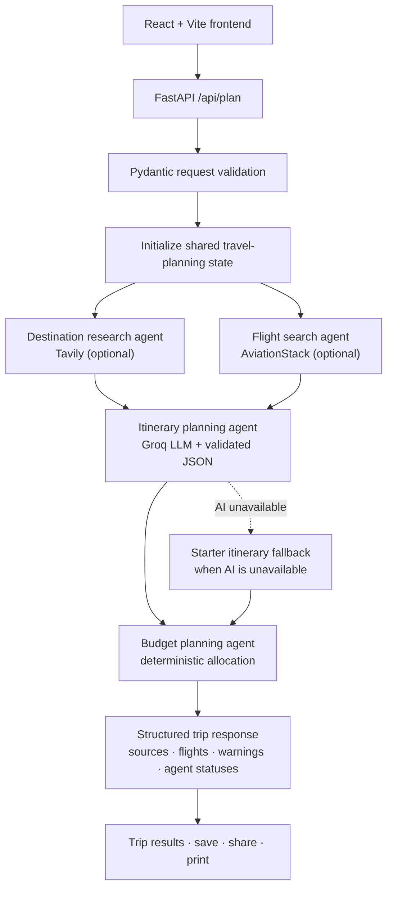

# Roam — AI Travel Planner

Roam is a responsive travel-planning app built with React, FastAPI, and LangGraph. Travelers enter their route, dates, party size, budget, interests, and an optional natural-language prompt such as “find local food and avoid busy attractions.” A graph coordinates destination research, optional flight lookup, itinerary generation, and budget planning.

## Architecture



### Request lifecycle

1. The React form sends a JSON `POST /api/plan` request. The optional custom prompt is limited to 500 characters.
2. FastAPI validates the request with Pydantic: supported currencies and travel styles, reasonable field sizes, valid three-letter airport codes, and trips no longer than 21 days.
3. The compiled LangGraph workflow initializes a shared `TravelPlanningState`.
4. The destination research and flight-search agents run as parallel graph branches. Each returns its results, warnings, and an execution-status entry.
5. After both branches finish, the itinerary-planning agent combines the request and available destination research with the custom travel prompt. When configured, it calls Groq's OpenAI-compatible chat-completions API in JSON mode, validates the response against Pydantic itinerary models, and verifies that the generated itinerary has exactly one day per trip day. Flight results are returned to the user but are not currently passed into the LLM prompt.
6. If Groq is not configured, its request fails, or the response is invalid, the itinerary agent returns a clearly labelled deterministic starter plan instead.
7. The budget-planning agent splits the user's stated budget into five fixed categories: stay (35%), food (25%), experiences (20%), getting around (12%), and flex fund (8%). This is a deterministic planning estimate—not a price prediction, live quote, or currency conversion.
8. FastAPI returns the validated itinerary, budget breakdown, any available sources and flights, integration warnings, and agent statuses. The React interface renders the itinerary and graph progress.

### Graph and agent responsibilities

| Graph node | Responsibility | Behavior when integration is not configured |
| --- | --- | --- |
| `destination_research_agent` | Search for current destination guides with Tavily; return HTTPS sources to the itinerary agent. | Skip live research and record a configuration warning. |
| `flight_search_agent` | Look up flights using departure and arrival IATA codes and the departure date. | Skip unless both codes and an Aviationstack key are supplied. |
| `itinerary_planning_agent` | Ask Groq for a personalized, unhurried itinerary using trip details, research, and the optional custom prompt. Validate its structured response. | Return the deterministic starter itinerary if AI is unavailable or invalid. |
| `budget_planning_agent` | Divide the user's budget using fixed, documented category ratios. | Always runs; it does not depend on paid APIs. |

This is a fixed, typed LangGraph workflow with parallel specialist nodes and a deterministic fallback—not an open-ended autonomous agent, booking agent, or multi-agent conversation. The external services do not book flights or accommodations.

### Shared graph state

`TravelPlanningState` carries the validated `TripRequest`, trip length, sources, flights, generated `TripDraft`, budget breakdown, integration warnings, and agent-status records. LangGraph reducers append branch warnings and status entries when parallel nodes complete.

### Main components

| Path | Responsibility |
| --- | --- |
| `frontend/src/App.jsx` | Trip form, custom prompt, results, agent-status display, saved trips, sharing, and printing. |
| `frontend/src/styles.css` | Responsive visual design and accessible interaction states. |
| `frontend/vite.config.js` | Local development proxy from Vite to FastAPI. |
| `app.py` | Pydantic models, Groq itinerary generation, LangGraph state/nodes, API routes, and production static-file serving. |
| `tools/tavily_tool.py` | Bounded-timeout Tavily destination search and source normalization. |
| `tools/flight_tool.py` | Bounded-timeout Aviationstack lookup and flight normalization. |
| `tests/test_app.py` | API validation, integration-free fallback, budget, and graph-response tests. |
| `render.yaml` | One-service Render deployment configuration. |

## Features

- Personalized day-by-day trip drafts, with optional natural-language preferences.
- Optional live destination research and source links.
- Optional flight data using three-letter airport codes.
- Itemized budget-planning guide in the selected currency (no conversion performed).
- Agent execution status shown alongside results.
- Browser-local saved trips, native sharing or clipboard copy, and print-friendly plans.
- Explicit integration warnings and an itinerary fallback when paid providers are unavailable.

## Run locally

Requirements: Python 3.10+ and Node.js 20+.

1. Copy `.env.example` to `.env`. Add provider keys if you want live AI and travel data; the planner also works without them.
2. Install dependencies and start FastAPI:

   ```powershell
   py -m venv venv
   .\venv\Scripts\Activate.ps1
   pip install -r requirements.txt
   uvicorn app:app --reload
   ```

3. In a second terminal, start the React development server:

   ```powershell
   cd frontend
   npm ci
   npm run dev
   ```

   Open the URL printed by Vite (usually `http://localhost:5173`). Vite proxies `/api` requests to FastAPI on port 8000.

## API

- `GET /api/health` returns the service status, configured feature flags, and `orchestration: "langgraph"`. It never returns API credentials.
- `POST /api/plan` accepts origin, destination, departure and return dates, traveler count, budget, currency, travel style, interests, optional airport IATA codes, and an optional prompt. It returns the itinerary, per-day dates and activities, suggested budget breakdown, sources, flights, warnings, `generated_by`, and ordered `agent_steps`.
- Invalid input returns FastAPI/Pydantic validation errors with HTTP 422.
- The interactive API reference is available at `/docs` when the service is running.

## Environment variables

Configure these in your local `.env` or hosting-provider settings. Never commit real secrets or add them to frontend code.

| Variable | Enables | Where to get it |
| --- | --- | --- |
| `GROQ_API_KEY` | AI-generated itineraries | [console.groq.com](https://console.groq.com/) |
| `GROQ_MODEL` | Optional Groq model override | Defaults to `llama-3.3-70b-versatile`. |
| `TAVILY_API_KEY` | Live destination research | [app.tavily.com](https://app.tavily.com/) |
| `AVIATIONSTACK_API_KEY` | Flight search when both airport codes are supplied | [aviationstack.com](https://www.aviationstack.com/) |
| `CORS_ORIGINS` | Allowed browser origins if hosting the frontend separately | Comma-separated URLs; defaults to local Vite development origins. |
| `VITE_API_URL` | API base URL if building a separately hosted frontend | Leave unset for the included single-service deployment. |

## Tests and production build

From the project root:

```powershell
.\venv\Scripts\python.exe -m unittest discover -s tests -v
cd frontend
npm ci
npm run build
```

## Deploy on Render

The included Blueprint builds the Vite frontend and serves it, together with the FastAPI API, from one Render web service.

1. Push the repository to GitHub.
2. In Render, choose **New + → Blueprint**, select this GitHub repository and branch, and apply the configuration in `render.yaml`.
3. Add optional provider keys in Render's environment settings and redeploy.
4. Visit the generated service URL and check `/api/health`.

The deployed frontend and API share an origin; a separate frontend host and production CORS configuration are not required. The free hosting tier may sleep while idle. Saved trips use browser `localStorage`, so they are not shared across devices and there is no account or server-side database.

## Resume-ready project description

**Roam — LangGraph Travel Planning Assistant** | Python, LangGraph, FastAPI, React, Groq, Tavily

- Built a typed LangGraph workflow that runs destination research and optional flight lookup as parallel specialist nodes, then coordinates itinerary and budget-planning nodes.
- Integrated Groq structured-JSON generation with Pydantic validation, a user-provided natural-language trip prompt, trip-length checks, and a deterministic fallback when the LLM is unavailable.
- Developed and deployed a responsive React/FastAPI application with source-linked travel research, optional flight results, budget breakdowns, and visible agent execution statuses.

Describe the budget as a **fixed-ratio planning breakdown**, not an AI-generated estimate. Describe the workflow as **LangGraph-orchestrated specialist nodes**, not autonomous agents that book travel.
